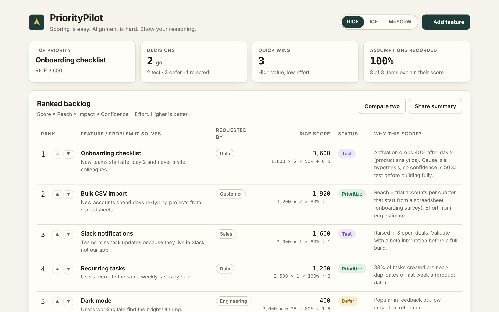
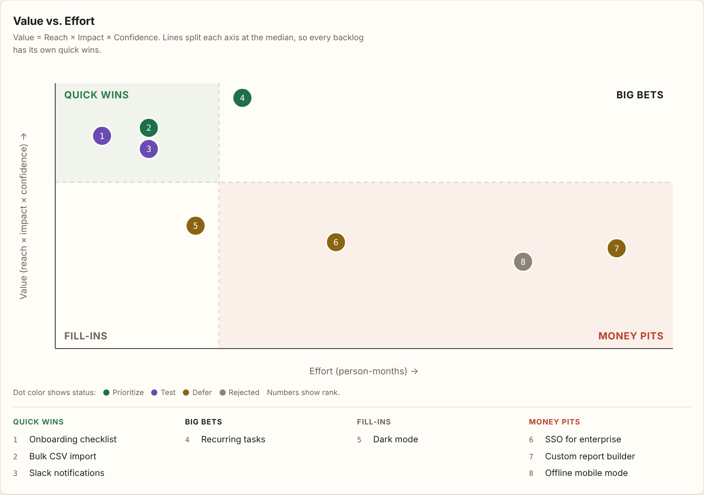
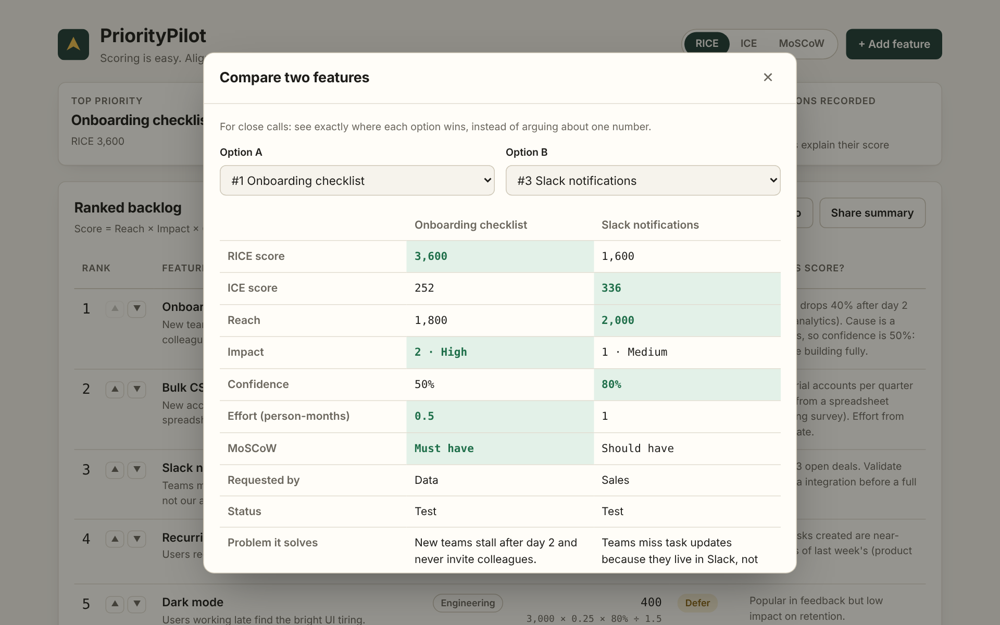
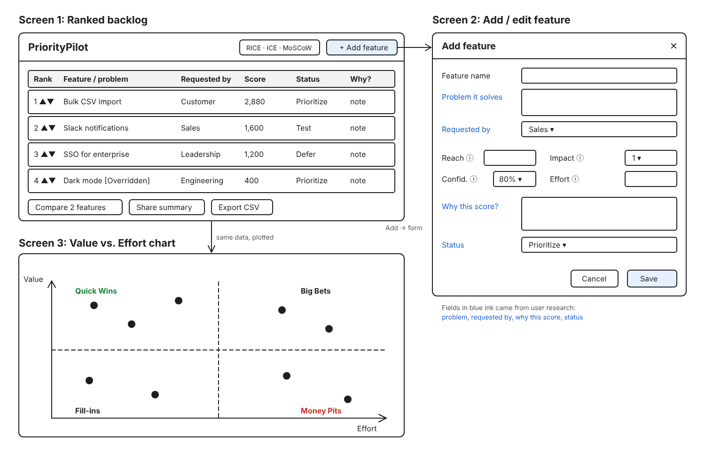

# PriorityPilot

**A feature prioritization tool that makes the reasoning behind every score visible, so product teams can align on what to build next.**

Rank a backlog with RICE, ICE, or MoSCoW. Record the problem each feature solves, who asked for it, and *why* it got its score. Compare close calls side by side, flag manual overrides openly, and copy a plain-English summary for stakeholders.

🔗 **Live demo:** https://mathangi-muralidharan.github.io/priority-pilot/
📄 **Product docs:** [PRD](docs/PRD.md) · [User research](docs/user-research.md) · [Backlog](docs/backlog.md) · [Feedback](docs/feedback.md)

---

## The problem

I set out to build a tool that scores features. My first user interview changed that.

> "The actual scoring can be fairly straightforward, but understanding the customer problem, validating the data, and getting engineering, design, sales, and leadership aligned can take much longer."
> — Product Manager (anonymous), user interview

PMs already know RICE, and a spreadsheet can do the arithmetic. What breaks down is **alignment**: stakeholders can't see the assumptions behind a number, close calls get decided by whoever argues hardest, and a request from an important customer competes with what the data says.

**Reframed problem statement:** PMs need a way to make prioritization assumptions and trade-offs transparent, so ranking decisions are easier to explain, challenge, and defend.

## Who it's for

PMs at growing SaaS companies who own a backlog of 20+ items, take requests from sales, leadership, customers, and data, and currently score in a spreadsheet. ([Full persona](docs/PRD.md#2-target-user))

## What it does, and the research behind each feature

| Feature | Why it exists |
|---|---|
| **RICE / ICE / MoSCoW switcher** | Teams use different frameworks; the interviewee noted "the framework matters more than the tool." |
| **"Problem it solves" field** | "I start with the problem, not the feature." |
| **"Why this score?" notes** | A score is only trusted when "the criteria and assumptions are clear." |
| **"Requested by" tag** | Stakeholder requests often compete with what the data suggests. Making the source visible keeps that trade-off honest. |
| **Status: Prioritize / Test / Defer / Rejected** | Real outcomes aren't yes/no: "we agree to test it or defer it." |
| **Compare two features** | "The hardest decisions are usually the ones where two options both have a strong case." |
| **Manual override, always labeled** | Frameworks inform; PMs decide. Overrides are allowed but flagged ("score says #3"), so judgment is visible, not hidden. |
| **Share summary** | One click turns the ranking and its rationale into text for Slack or email. |
| **Value vs. Effort chart** | Shows quick wins and money pits at a glance. Quadrants split at the median, so every backlog has its own reference point. |
| **CSV import / export, no login** | The tool has to beat a spreadsheet on clarity, not on setup cost. |

## Product decisions and trade-offs

- **Browser storage instead of accounts.** Shipping without a backend let me test the core value (transparent prioritization) fast and for free. Trade-off: data lives on one device, so CSV export is the safety net. Accounts move up the roadmap if testers ask for them.
- **Overrides are visible, never silent.** I considered blocking overrides to keep the ranking "pure", but real PMs adjust for context a formula can't capture. Labeling them turns an override into a conversation instead of a hidden edit.
- **No AI-suggested scores.** It would be a flashy feature, but it hides the exact assumptions this product exists to expose.
- **MoSCoW ranks by category, then RICE.** MoSCoW alone produces big ties; using RICE inside each category keeps the order meaningful.
- **Median-split quadrants with a square-root value scale.** Fixed thresholds made every item a "money pit" in small backlogs, and a linear scale squashed most dots into one corner.

## How I validated it

- **Scoring math:** RICE and ICE results are checked against hand calculations for all eight sample features in an automated browser test.
- **Usability:** I tested the full flow (add, edit, override, compare, share, CSV round trip) on desktop and on a phone-sized screen in light and dark mode.
- **User testing:** in progress. Results and the changes they lead to are recorded in [feedback.md](docs/feedback.md).

## Process

1. **Discovery:** async interviews with PMs ([research notes](docs/user-research.md)). Interview 1 shifted the problem from *scoring* to *alignment*. Next, I wrote [hypotheses for four PM segments](docs/user-research.md#hypotheses-to-validate-not-interview-data) and an [interview guide](docs/interview-guide.md) to test them before building anything new.
2. **Definition:** one-page [PRD](docs/PRD.md) with goals, success metrics, scope, and out-of-scope items with reasons.
3. **Design:** low-fidelity [wireframes](docs/wireframes.png); fields added because of research are marked in blue.
4. **Build:** vibe coded with AI assistance as a static web app (HTML, CSS, JavaScript; no framework, no build step).
5. **Plan and track:** user stories with acceptance criteria in the [backlog](docs/backlog.md), each tied back to its research source.

## Success metrics

| Goal | Metric | Target |
|---|---|---|
| Fast to use | Time to score and rank 10 features | Under 5 minutes |
| Assumptions are visible | Share of features with a "why this score?" note | 60%+ |
| Decisions are explainable | Testers who copy a share summary in their first session | 40%+ |
| Better than a spreadsheet | "Easier to explain priorities than my current tool" (1–5) | Average 4+ |

## Roadmap

- **v1.1:** improvements from user testing
- **v2:** stakeholder voting on scores, a shareable read-only link, and sending "Test" items straight to **TestPilot**, my A/B test planner, to design the experiment

## Run it locally

No install needed. Download the repo and open `index.html` in a browser. To host it, any static host works (GitHub Pages, Vercel, Netlify).

---

Built by **Mathangi Muralidharan** as a product management portfolio project.
