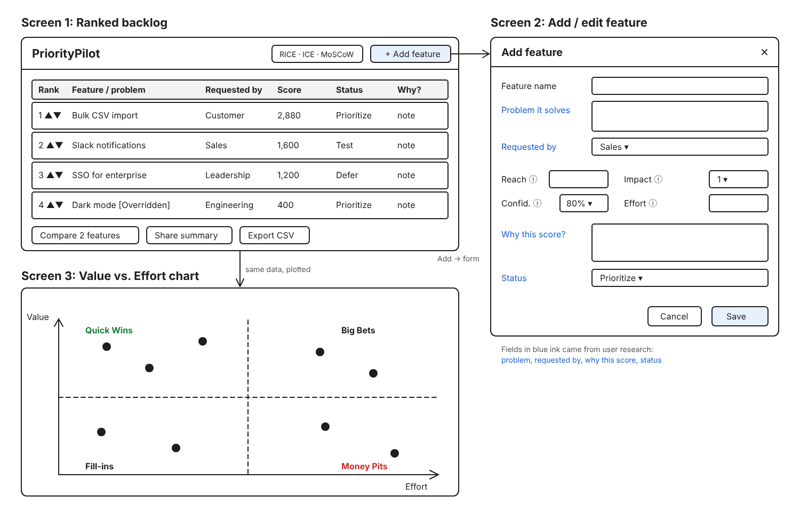

# PRD: PriorityPilot

**Author:** Mathangi Muralidharan · **Status:** MVP shipped · **Last updated:** November 2026

---

## 1. Problem

Scoring features is easy. Getting people to agree on the scores is hard.

Product managers already know frameworks like RICE and ICE, and a spreadsheet can do the arithmetic. What goes wrong is everything around the number: stakeholders can't see the assumptions behind a score, close calls between two strong options get settled by whoever argues loudest, and a request from an important customer or executive competes with what the data says, with no shared way to talk about the trade-off.

> "The actual scoring can be fairly straightforward, but understanding the customer problem, validating the data, and getting engineering, design, sales, and leadership aligned can take much longer."
> — Product Manager, user interview 1

**Problem statement:** PMs need a way to make their prioritization assumptions and trade-offs transparent, so that ranking decisions are easier to explain, challenge, and defend.

*How this changed:* I started with "PMs need a tool to score and rank features." User research showed the scoring was not the pain point; alignment was. The problem statement and the feature set were revised to match (see [user-research.md](user-research.md)).

## 2. Target user

**Primary persona: "Priya, the startup PM"**
- PM at a 20–200 person SaaS company, owns a backlog of 20+ items
- Gets requests from sales, leadership, customers, and her own data
- Uses a Google Sheet for scoring today; it works, but every planning meeting re-argues the same numbers
- Needs to walk engineering, design, sales, and leadership through *why* item A beats item B

**Secondary:** Associate PMs and PM candidates learning prioritization frameworks.

## 3. Goals and success metrics

| Goal | Metric | Target |
|---|---|---|
| Fast to use | Time to score and rank 10 features | Under 5 minutes |
| Assumptions are visible | % of scored features with a "why this score?" note | 60%+ |
| Decisions are explainable | Users who copy a share summary in their first session | 40%+ |
| Better than a spreadsheet | "Easier to explain priorities than my current tool" (1–5) | Average 4+ |

**Non-goal:** Replacing Jira or a full roadmap tool.

## 4. User stories

1. As a PM, I want to **add a feature with the problem it solves**, so the backlog stays anchored on customer problems, not solutions.
2. As a PM, I want to **score features with RICE, ICE, or MoSCoW**, so I can use the framework my team already knows.
3. As a PM, I want to **record why I gave each score**, so stakeholders can see and challenge my assumptions.
4. As a PM, I want to **see who requested each feature**, so stakeholder requests and data-driven items are compared openly.
5. As a PM, I want to **see a ranked list and a value vs. effort chart**, so quick wins and money pits are obvious.
6. As a PM, I want to **compare two features side by side**, so close calls are settled on specific criteria.
7. As a PM, I want to **override the rank when I have context the formula lacks**, and have that override shown clearly, so judgment stays visible instead of hidden.
8. As a PM, I want to **set a decision status (Prioritize, Test, Defer, Rejected)**, because real decisions aren't just yes or no.
9. As a PM, I want to **copy a plain-English summary of the priorities**, so I can share the rationale in Slack or email.
10. As a PM, I want to **import and export CSV**, so I can bring in my existing spreadsheet and take my data with me.

## 5. Scope

**In the MVP**
- Add, edit, delete backlog items (title, problem, requested by, scores, notes, status)
- RICE (default), ICE, and MoSCoW scoring with a framework switcher
- Ranked table and Value vs. Effort quadrant chart
- Manual rank override with an "Overridden" badge
- Side-by-side comparison of two features
- Share summary (copy to clipboard)
- CSV import and export
- Sample backlog preloaded; data saved in the browser (no account)

**Out of scope (and why)**
| Item | Reason |
|---|---|
| User accounts / login | Adds friction and backend cost; not needed to test the core value |
| Real-time team collaboration | Valuable, but first prove the single-PM workflow |
| Jira / Linear integration | CSV import covers the "bring my data" need for now |
| AI-suggested scores | Risks hiding the very assumptions the product is meant to expose |

## 6. Scoring definitions

**RICE** = Reach × Impact × Confidence ÷ Effort
- Reach: users affected per quarter
- Impact: 3 = massive, 2 = high, 1 = medium, 0.5 = low, 0.25 = minimal
- Confidence: 100% high, 80% medium, 50% low
- Effort: person-months

**ICE** = Impact × Confidence × Ease (each rated 1–10)

**MoSCoW** = Must have / Should have / Could have / Won't have (this time). Ranked by category, then by RICE score within each category.

**Value vs. Effort chart:** Value = Reach × Impact × Confidence. Quadrants split at the median of each axis: Quick Wins (high value, low effort), Big Bets (high value, high effort), Fill-ins (low value, low effort), Money Pits (low value, high effort).

## 7. Risks and open questions

- **Garbage in, garbage out:** a precise-looking score can create false confidence. *Mitigation:* "why this score?" notes and a confidence factor in every framework.
- **Overrides could make the tool pointless.** *Mitigation:* overrides are allowed but always labeled, so they become a conversation, not a hidden edit.
- **Browser-only storage** means data lives on one device. *Mitigation:* CSV export; accounts on the roadmap if users ask for them.
- **Open question:** Do teams want one shared score, or each stakeholder's score side by side? To explore in more interviews.

## 8. Wireframes

## 9. Release plan

| Milestone | Contents |
|---|---|
| **MVP** | Everything in "In the MVP" above |
| **v1.1** | Improvements from user feedback (see [feedback.md](feedback.md)) |
| **v2** | Stakeholder voting, shareable read-only link, link "Test" items to an A/B test planner |
